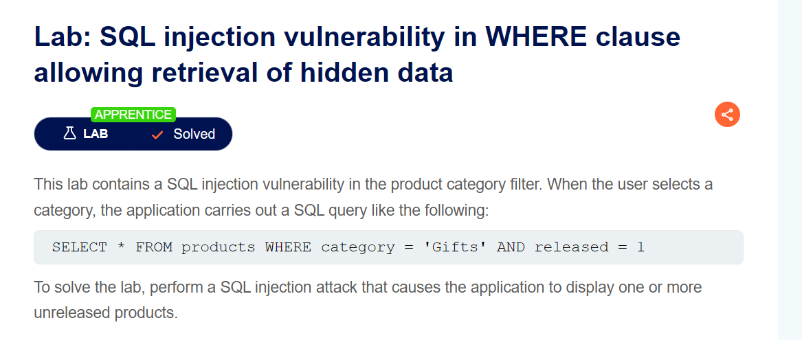
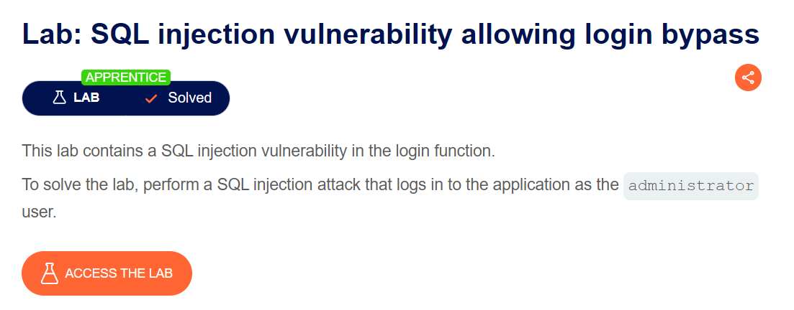

# PortSwigger Web Security Academy — SQL Injection Labs

## Lab 01: SQL Injection in WHERE Clause — Retrieval of Hidden Data

**Difficulty:** Apprentice  
**Status:** Solved  
**Vulnerability:** SQL Injection (SQLi)  
**Objective:** Retrieve unreleased products by manipulating the product category filter.

### Lab Description

The application uses a SQL query similar to the following to retrieve products:

```sql
SELECT * FROM products
WHERE category = 'Gifts'
AND released = 1;
```

The `category` parameter is vulnerable to SQL injection, allowing user input to alter the query's logic and potentially bypass the `released = 1` restriction.

### Exploitation

**Parameter:** `category`

**Payload:**

```sql
' OR 1=1--
```

### Why It Works

- `'` closes the original string literal.
- `OR 1=1` adds a condition that evaluates to true.
- `--` comments out the remaining SQL query when supported and correctly formatted.

This changes the query's logic, potentially bypassing both the category filter and the release restriction, allowing unreleased products to appear.

### Impact

- Unauthorized access to unreleased product data.
- Bypassing application-level filtering.
- Potential exposure of additional database information, depending on the query and database permissions.

### Remediation

- Use parameterized queries or prepared statements.
- Never concatenate untrusted input directly into SQL.
- Validate category values using an allowlist.
- Apply least-privilege database permissions.

### Evidence



**Result:** Successfully solved the Apprentice lab and retrieved hidden product records.

---

## Lab 02: SQL Injection — Login Bypass

**Difficulty:** Apprentice  
**Status:** Solved  
**Vulnerability:** SQL Injection in Authentication  
**Objective:** Log in as `administrator` without knowing the password.

### Lab Description

The login function is vulnerable because user input can alter the structure of the authentication query. A vulnerable query might resemble:

```sql
SELECT * FROM users
WHERE username = 'administrator'
AND password = 'user_input';
```

If the username is inserted directly into the query, SQL injection may allow an attacker to bypass password verification.

### Exploitation

**Parameter:** `username`

**Payload:**

```sql
administrator'--
```

### Why It Works

- `administrator` identifies the target account.
- `'` closes the username string.
- `--` comments out the remaining query, including the password condition, when the database recognizes the syntax.

The application may therefore authenticate the attacker as the administrator without validating the password.

### Impact

- Authentication bypass.
- Unauthorized administrator access.
- Potential privilege escalation and access to restricted functionality.

### Remediation

- Use parameterized queries for authentication.
- Never construct SQL statements through string concatenation.
- Verify passwords securely using appropriate password-hashing mechanisms.
- Apply rate limiting and monitor suspicious login attempts.

### Evidence



**Result:** Successfully solved the Apprentice lab by bypassing the vulnerable login query.

---

## Key Takeaways

| Aspect               | Lab 01: Hidden Data            | Lab 02: Login Bypass                            |
| -------------------- | ------------------------------ | ----------------------------------------------- |
| Vulnerable component | Product category filter        | Login function                                  |
| Objective            | Retrieve unreleased products   | Authenticate as administrator                   |
| Technique            | Boolean condition manipulation | SQL comment-based bypass                        |
| Impact               | Unauthorized data disclosure   | Authentication bypass                           |
| Primary defense      | Parameterized queries          | Parameterized queries and secure authentication |

Both labs demonstrate that **user input must be treated as data, not executable SQL**. Parameterized queries are the primary defense because they separate SQL query structure from user-supplied values.

## References

- [SQL Injection — PortSwigger Web Security Academy](https://portswigger.net/web-security/sql-injection)
- [Lab 01: Retrieve Hidden Data](https://portswigger.net/web-security/sql-injection/lab-retrieve-hidden-data)
- [Lab 02: Login Bypass](https://portswigger.net/web-security/sql-injection/lab-login-bypass)
